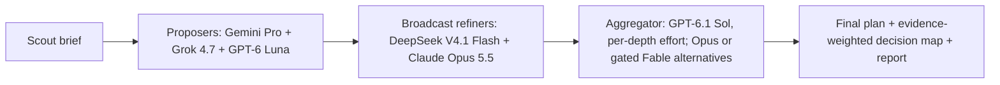

# Architecture

MoA-X adapts the 2024 Mixture-of-Agents method
([Wang et al., arXiv:2406.04692](https://arxiv.org/abs/2406.04692)) to
repo-grounded implementation planning.

## Four layers

**Layer 0: scout.** The parent/transport freezes the request and explicit scope.
The runner adds bounded static reconnaissance of relevant code, interfaces and
tests, together with the shared attachment context.

**Layer 1: independent proposals.** Gemini Pro contributes Google-backed web
research, Grok contributes an xAI lane, and GPT-6 Luna contributes an
OpenAI planning lane. They run in parallel and cannot see each other's work.

**Layer 2: broadcast refinement.** DeepSeek V4.1 Flash and Claude Opus each receive
every surviving proposal. They verify claims, identify disagreements, add
missing evidence, and produce structured review output. Broadcast refinement
is paper-faithful and gives every reviewer the same comparison surface.

**Layer 3: decision.** GPT-6.1 Sol is the default recorded aggregator. Quick uses `medium` synthesis
effort; Balanced/Thorough and the default CLI provider use `xhigh`. Explicit
CLI effort takes precedence over resolved provider effort. The selected effort
reaches both the native call and provenance metadata.
It consumes only validated upstream artifacts, resolves disagreements without
hiding them, and writes the final Markdown plan plus exact JSON decision
lineage. Claude Opus is an alternative aggregator. Fable is aggregator-only
and warning-gated because it can consume extreme quota.

## Derived evidence layer

At each retained checkpoint, `harness/scripts/decision_map.py` derives
`decision-map.json` from the validated proposer payloads, refiner findings,
final-plan lineage, and manifest. Models never choose graph identifiers,
quality scores, or gates. Normalized claim text and source records receive
content-addressed IDs, allowing the same evidence → claim → verification →
decision relationships to evolve from proposals through final synthesis.

The first live checkpoint also records repository commit/tree identity and
hashes of Git status and diff state. Code evidence receives file and cited-line
hashes when the repository still matches that receipt; raw repository files
and diffs are not copied into the map. External evidence retains its canonical
URL and a hash of the model-declared snippet, but is labeled as a declared
excerpt rather than a captured web-page snapshot. Sensitive, unsafe, binary,
symlinked, oversized, or unreadable paths fail closed at the receipt boundary.

Deterministic gates cover receipt integrity, review coverage, contradictions,
verification by independent model labs, source diversity, final-step evidence
coverage, and pointer integrity. The aggregator's stated confidence remains
visible, but an evidence ceiling caps the effective confidence when those
gates are incomplete. Map generation is best-effort: a failure warns without
invalidating otherwise usable planning artifacts. Legacy sessions remain
readable with unavailable or drifted receipt states made explicit.

## Lab diversity and execution harnesses

A route is a `{name, harness, model}` triple:

- `name` is the stable route id and payload `agent_id`;
- `harness` is the local CLI transport (`codex`, `claude`, `opencode`, `agy`,
  or the legacy standalone `gemini` adapter);
- `model` is the exact model id sent to that CLI.

The producing model lab is a separate field. This distinction is
load-bearing: OpenCode executes xAI, DeepSeek, Zhipu, MiniMax and Meta routes but is not
itself a model lab. The Web UI therefore groups and illustrates routes by
`lab_id`, while the provider-health page reports the execution harness used to
reach those labs. The canonical mapping and asset names live in
`harness/scripts/model_labs.py`.

Unknown custom routes receive an `independent` lab identity until their model
prefix can be mapped explicitly. Historical Moonshot, GLM, DeepSeek, Composer,
and Cursor-Grok manifests remain attributable for archive rendering. GLM 5.3
and DeepSeek V4.1 Flash are available after live full-schema qualification;
GLM is a Thorough proposer and DeepSeek V4.1 Flash is a recommended refiner.

## Why this roster

- Gemini Pro enters every recommended mode because its Google-backed web
  search is valuable before refinement.
- Grok enters every mode as an independent xAI proposal lane.
- Balanced adds GPT-6 Luna; Thorough adds GPT-6 Astra for a deeper OpenAI
  proposer pass without relying on the less reliable retired routes.
- DeepSeek V4.1 Flash is present in every refinement profile.
- Opus joins Balanced and Thorough, using high and max effort,
  respectively.
- The recommended refiners remain lab-independent from the OpenAI aggregator.

The default keeps one model from each lab in a layer. DeepSeek Pro was removed
from the active catalog during the October 2026 refresh; old manifests retain
its original identity. Qwen, Moonshot and MiMo remain attributable in archives
and are excluded from new launches, including custom aliases.

## Provider recovery

All CLI, web and Slack runs use the orchestrator's shared recovery path for
proposers, broadcast reviewers and final aggregation. Each provider's configured
timeout is a total deadline across its attempts, backoff and optional repair.
Research calls reserve 20% of the lane budget, up to 240 seconds, for a
tool-free repair within that deadline. Explicit deadlines of 60 seconds or less still permit an initial
call without a repair reserve. Defaults allow 45 minutes for Claude, OpenCode,
Google and high/xhigh Codex lanes; low/medium Codex lanes retain 15 minutes.
Shorter configured budgets remain respected. Adapters subtract preparation time
and reserve up to eight seconds for process termination and output draining.
AGY has no extra watchdog grace beyond that budget. Git sandbox commands share
the invocation deadline and write only an independent checkout; interruptions
cannot leave locks or worktree registrations in the source repository.

- Capacity/rate limits, temporary transport failures and incomplete output can
  receive two retries, for at most three research invocations. This includes an
  OpenCode HTTP 200 stream that terminates without `finish_reason`, or a typed
  `provider.internal` / `server_error` failure inside a successful HTTP response; its partial
  text is retained in logs and never accepted as a completed response. Backoff starts at
  five seconds, then fifteen seconds, with jitter. Provider retry hints in
  seconds, milliseconds, minutes or HTTP-date form can extend backoff within
  the remaining deadline. A new research attempt requires at least three
  minutes after backoff and the repair reserve; insufficient time ends recovery
  without buying a doomed request.
- Authentication, unavailable model access, exhausted billing quota and invalid
  configuration fail immediately. Models and effort stay fixed during research retries.
- Parseable output rejected by schema, evidence or verification validation gets
  one structure repair with all tools disabled and a maximum of 240 seconds,
  clipped to the remaining deadline. Native Codex/Claude mechanical repairs use
  medium effort, independently recorded, so high/max research reasoning does
  not consume the formatting window. AGY/Gemini use authenticated Claude Opus
  for this mechanical repair because their CLIs lack a tool-free invocation
  mode. OpenCode prefers the same native Claude repair when that client is
  authenticated, retaining its own tool-free backend when Claude is unavailable.
  If cached Claude credentials or CLI/model compatibility fail before any payload
  is produced, one fallback dispatch can use the original backend inside the
  same 240-second repair window. This never restarts research, resets a deadline,
  or retries generated content, evidence failures, safety refusals or billing errors.
  The repair receives only the original object, errors and schema; its
  harness and model are recorded separately from the originating lane. A local
  guard rejects invented text/citations, recombined evidence records and
  changed decision lineage.

OpenCode plan-boundary recovery reads complete JSON string tokens and changes
only punctuation between a risks array and the next step/root collection.
It preserves all supplied scalar values and citation records, including the
final plan item, rather than sending a truncated prefix to schema repair.
Quoted JSON examples and risks ordered before a step remain untouched.

AGY also receives its native `--json-schema` contract through a file inside the
isolated workspace. Invalid output never enters refinement. A failed repair
fails closed; it does not restart research. Workspace mutation is terminal.
Cancellation interrupts the provider process tree or backoff promptly.

Each attempt has a distinct log and a manifest record with its harness, model,
timing, failure category and outcome; `stop_reason` records why recovery ended.
Payloads and manifests are replaced atomically. Successful lanes remain retained during
manual redispatch. The web worker does not apply an extra automatic retry loop.
A structurally valid review with missing sources or safe missing/out-of-range
local receipts keeps its independent advice and other checks. The runner marks
those findings `unverified`, annotates the finding, and records their original
records and reasons in `verification_warnings` in the manifest and attempt. It
never invents a URL, clamps a line range, or upgrades a claim. The decision map
retains the original declared status and evidence debt; the portal, report and
Slack expose the citation warnings. Unsafe paths, symlinks, sensitive files,
binary sources and malformed locators still fail closed. A malformed numeric
line range on a separately checked safe local file is cleared and marked
unverified, with its original locator retained in the audit. Any other validation
failure uses the single bounded repair; the worker never hides rejected lanes.
Repo-local absolute reviewer receipts are normalized to portable relative
locators before semantic validation; external absolute paths remain invalid.

## Read-only and process isolation

Codex and Claude receive their native structured-output controls. OpenCode
receives an isolated permission config that denies edits and shell access.
AGY requires plan mode plus sandboxing. For Git workspaces, MoA-X also copies
visible tracked, staged, dirty, and untracked file bytes into a independent detached
checkout below the active session and sets `UV_NO_SYNC=1`. This contains any
pre-sandbox `uv` bootstrap files while keeping repository context accurate.
Every CLI call runs in its own process group, and the runner compares per-path
fingerprints so a concurrent lane is only associated with paths that actually
changed during its interval.

## Why CLI, not SDK

The CLIs already own authentication, provider routing, retries, and
model-specific behavior. MoA-X records the resolved CLI/model/effort in each
manifest instead of duplicating vendor SDKs. Normalized usage and cost
accounting remains a future improvement.

## Non-goals

- chat-answer benchmarking;
- forcing a failed route to pass by weakening schemas;
- treating an execution harness as a model lab;
- committing `.moa` session artifacts.

### OpenCode V2 isolation

The adapter detects V1/V2 before dispatch. V2 runs a private server with a
custom primary read-only agent in a disposable repository snapshot. The
snapshot mirrors dirty Git-visible state, receives a private `.opencode`
configuration, and is removed after the subprocess ends. Task-only workspaces
are copied; tool-free repair calls use an empty scratch workspace. Both cwd
and PWD point to the snapshot because the V2 CLI resolves PWD first.

Only read, glob, grep, and optional web fetch/search are allowed. Edit, shell,
subagents, questions, MCP tools, and credential-file reads remain denied.
The private configuration home prevents unrelated user plugins and MCP
servers from loading while account state stays in the default data directory.
Web search chooses an available provider automatically instead of opening a
headless selection prompt. V2 emits NDJSON: only text parts feed JSON extraction, and typed error events
fail closed. V1 retains its original invocation and policy contract.

## Conversation transport

The Slack gateway persists envelopes before acknowledgement, conducts bounded
Luna interviews outside callbacks, and launches through the same service as
the browser. Both entry points use `harness/webui/rosters.py`. Slack adds
workspace membership and request ownership, durable event/action deduplication,
draft versions, stable launch IDs and a reconciled message/file outbox. It
does not construct Flask or start a second ensemble worker.

Read-only run capabilities expose one job's status and retained artifacts for
30 days, without browser-profile or mutation access. Local filesystem roots
are not accepted through Slack. Uploaded references are bounded and owned by
the caller; private repositories require a separate explicit allowlist.

Synthesis-only retries retain validated proposal/review checkpoints and the
synthesis input. Only Layer 3 executes; prior aggregator attempts stay visible
in the report, while current timeout summaries reflect the replacement result. Workspace
mutation warnings remain recorded; synthesis-only retries cannot reuse inputs
from a run that recorded workspace changes.

The detailed [v2 evidence pipeline](evidence-pipeline.md) defines verification allocation, source capture, exact adopted claims, structured rendering and final audits.
